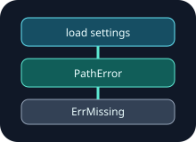

## 🧭 Overview

A small Go CLI demonstrating wrapped errors, sentinel matching with errors.Is, and typed error extraction with errors.As.

## ✨ Features

- 🔗 Build a wrapped error chain with %w.
- 🎯 Match a sentinel error using errors.Is.
- 🧭 Extract a custom PathError using errors.As.
- 🧪 Run focused standard-library tests.

## 🎬 Demo

No hosted demo is provided. The examples run locally and use only the inputs documented below.

## ⚡ Quick Start

~~~bash
go run .
~~~

## 🧰 Tech Stack

- Go 1.22+
- Standard library or the small dependencies listed in the project manifest

## 🗂️ Folder Structure

~~~text
go-error-wrapping-lab/
├── main.go
├── main_test.go
├── go.mod
├── assets/mark.svg
├── .gitignore
├── LICENSE
└── README.md
~~~

## 🗺️ Roadmap

- [x] Core behavior and local examples
- [x] README and custom SVG illustration
- [ ] Add more guided exercises from community feedback

## 🤝 Contributing

Issues and focused pull requests are welcome. Keep examples reproducible, local-first, and within the stated scope.

## 📄 License

MIT License. See [LICENSE](LICENSE).

